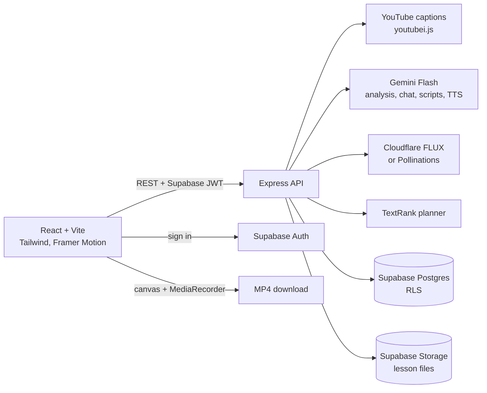

# VideoMind AI

Turn any YouTube video into a transcript, summary, study kit and a tutor you can question, or turn a topic into a narrated video lesson or a short course. In 15 languages, including 8 Indian ones, on free tiers only.

[](https://github.com/Yashwanthdot7/VedioMind-AI/actions/workflows/ci.yml)


<sub>Demo recorded against the local test backend (a stand-in YouTube player and canned AI replies), so it runs offline. Real runs use YouTube and Gemini.</sub>

## What it does

**Understand a video.** Paste a YouTube link and get:
- a searchable transcript that follows the video and jumps to any line
- a summary with key takeaways
- a chat tutor whose answers cite clickable timestamps

**Study it.** One click makes notes, an 8-question quiz, flashcards or a mind map, at Kids, Student or Teacher level. Notes export as Markdown, flashcards as Anki or Quizlet CSV, and the mind map as SVG.

**Learn a topic as video.** Type a topic, paste notes, or pick a summarized video:
- **One lesson:** a narrated explainer with a 3D-style AI picture in every scene, Gemini voices, captions and MP4 download.
- **A course:** the same material split into 3 to 5 modules that build on each other. Module 1 plays while the rest are being made.
- Quizzes and tests are made only when you ask for them.

**Share with a class.** Teachers turn on a link (and a QR code for the projector) for any lesson or course. Students open it on their phones and watch or take the quiz without an account.

**Track progress.** Every quiz is graded A+ to D. The progress page shows score over time, accuracy by difficulty, streaks and the questions worth revisiting.

## Engineering highlights

- **TextRank scene planning, measured.** Long notes and 40-minute transcripts are condensed to their key sentences before the script is written. It works in any script, including captions with no punctuation. On a hand-labelled benchmark with a 25% budget it covers nearly twice as many key points as cutting the text off (47% vs 25%, details below).
- **Course pipeline.** Gemini outlines the modules. Each sentence of the source then goes to the module it's about, and the modules are generated one at a time as background jobs with live progress. If one module fails, the course keeps the others.
- **Free-tier design, with no paid fallback anywhere:**
  - Transcripts: YouTube captions → youtubei.js → Gemini watching the video.
  - Pictures: Cloudflare FLUX → Pollinations → drawn slides.
  - Voice: Gemini TTS → the browser's own voice.
  - Hitting a quota degrades the result instead of sending a bill.
- **Background jobs.** Lessons and courses return at once and fill in scene by scene: script, then pictures and narration in parallel. Files are kept in Supabase Storage so they survive restarts on free hosts.
- **MP4 export in the browser.** A canvas renderer plus MediaRecorder, so there is no render server.
- **Multi-script UI.** The Anek type family covers Latin and seven Indian scripts.
- **Security.** Owner-only edits on shared items (a test caught and fixed a student-delete hole), Supabase Row Level Security, server-computed quiz grades, per-user rate limits, and the secret key kept on the server.
- **Tests.** 70 backend tests (YouTube, Gemini, voice and pictures faked) plus typecheck, lint and build, run on every push by [GitHub Actions](.github/workflows/ci.yml).

## Architecture



## Scene planning, measured

What should the script writer read when the material is too long for it? Four methods were compared at the same character budget on [6 hand-labelled texts](backend/eval/scene-planning/): lecture transcripts, textbook notes, unpunctuated auto-captions and a Hindi text.

| Budget: 25% of the text | Key points covered | ROUGE-1 recall | ROUGE-2 recall |
|---|---:|---:|---:|
| First part only (plain cut-off, the old behaviour) | 25% | 0.277 | 0.099 |
| Evenly spaced sentences | 36% | 0.304 | 0.108 |
| Random sentences (mean of 30 runs) | 41% | 0.346 | 0.128 |
| **TextRank** | **47%** | **0.409** | **0.173** |

The 40% budget shows the same order. The set is small, and one document shows no gain; both are noted in [RESULTS.md](backend/eval/scene-planning/RESULTS.md) and the [benchmark README](backend/eval/scene-planning/README.md). To reproduce, run `node backend/scripts/compareScenePlanning.js`. Add `--live` to compare real Gemini lessons (needs a key). CI prints the table on every run.

## Tech stack

| Layer | Technology |
|---|---|
| Frontend | React 18, TypeScript, Vite 8, Tailwind CSS, Framer Motion, Lucide, react-youtube |
| Backend | Node.js, Express, express-rate-limit, node:test |
| AI | Gemini Flash (auto-selected with fallback): JSON-mode analysis, chat, scripts, course outlines, TTS. FLUX.1-schnell for pictures |
| Data | Supabase Postgres, Auth (email, optional Google), Row Level Security, Storage |
| CI | GitHub Actions: backend tests, frontend typecheck, lint and build |

## Getting started

### Prerequisites
- [Node.js](https://nodejs.org/) **v20.19+ or v22.12+** (required by Vite 8)
- A [Google Gemini API key](https://aistudio.google.com/app/apikey) (free tier works)
- *(Optional)* a free [Supabase](https://supabase.com) project

### 1. Clone

```bash
git clone https://github.com/Yashwanthdot7/VedioMind-AI.git
cd VedioMind-AI
```

### 2. Quick start (one command)

From the project root:

```bash
npm run setup     # installs root, backend and frontend dependencies (first time only)
npm run dev       # starts backend (:3001) and frontend (:5173) together
```

Create `backend/.env` and `Frontend/.env` first (see the tables below). Press `Ctrl+C` once to stop both.

Prefer separate terminals? Use the steps below.

### 2a. Backend (separately)

```bash
cd backend
npm install
cp .env.example .env     # then edit .env
npm run dev              # http://localhost:3001
```

| Variable | Required | Description |
|---|---|---|
| `GEMINI_API_KEY` | ✅ | Your Gemini key |
| `GEMINI_MODEL` | | Model to try first. Empty = newest Flash, with automatic fallback if a model is retired |
| `PORT` | | Defaults to `3001` |
| `CORS_ORIGINS` | | Comma-separated allowed frontend URLs (default `http://localhost:5173`) |
| `CLOUDFLARE_ACCOUNT_ID`, `CLOUDFLARE_API_TOKEN` | optional | Free AI pictures (~170/day, no card). See below |
| `POLLINATIONS_TOKEN` | optional | Pictures work without it; a free token makes them faster |
| `SUPABASE_URL` | for accounts | Supabase → Project Settings → API |
| `LESSON_PLANNER` | | `textrank` (default) condenses long lesson material first; `off` sends it as is |
| `SUPABASE_SECRET_KEY` | for accounts | The `sb_secret_…` key (or legacy `SUPABASE_SERVICE_ROLE_KEY`). **Server only — never put this in the frontend or commit it** |

### 2b. Frontend (separately)

```bash
cd Frontend
npm install
cp .env.example .env     # then edit .env
npm run dev              # http://localhost:5173
```

| Variable | Required | Description |
|---|---|---|
| `VITE_API_URL` | ✅ | Backend URL, e.g. `http://localhost:3001/api` |
| `VITE_SUPABASE_URL` | for accounts | Same project URL as the backend |
| `VITE_SUPABASE_PUBLISHABLE_KEY` | for accounts | The public `sb_publishable_…` key (or legacy `VITE_SUPABASE_ANON_KEY`) |

### Free AI pictures for video lessons (optional, 5 minutes)

Pictures already work without any setup through **Pollinations.ai** (free, about one picture every 15 seconds). For faster pictures, add a free **Cloudflare** account:

1. Sign up at [dash.cloudflare.com](https://dash.cloudflare.com) (free plan, no credit card).
2. Go to **AI → Workers AI → Use REST API**.
3. Copy your **Account ID** and click **Create a Workers AI API Token**.
4. Put both in `backend/.env` as `CLOUDFLARE_ACCOUNT_ID` and `CLOUDFLARE_API_TOKEN`, then restart.

The free plan gives 10,000 Neurons a day, about 170 pictures (about 25 lessons). It resets at 05:30 IST, and going over the limit only falls back to Pollinations, never to a bill.

### 3. Supabase setup (optional, for accounts & library)

1. Create a project at [supabase.com](https://supabase.com).
2. **SQL Editor → New query** → paste [`supabase/schema.sql`](supabase/schema.sql) → **Run**.
   - Already ran it before? Run the migrations you don't have yet, once each: [`002_quiz_attempts.sql`](supabase/migrations/002_quiz_attempts.sql) (quiz analytics), [`003_courses.sql`](supabase/migrations/003_courses.sql) (courses and the lesson files bucket), [`004_sharing.sql`](supabase/migrations/004_sharing.sql) (class links for courses).
3. **Authentication → URL Configuration**: set *Site URL* to your frontend URL (e.g. `http://localhost:5173`) and add it to *Redirect URLs*.
4. **Authentication → Providers → Google**: enable it and paste a Google OAuth client ID/secret ([guide](https://supabase.com/docs/guides/auth/social-login/auth-google)). Then set `VITE_ENABLE_GOOGLE_AUTH=true` in `Frontend/.env` to show the button. Email sign-in works without this step.
5. Put the URL and keys in both `.env` files and restart.

Then run `cd backend && npm run check:supabase`. It checks every table and storage bucket and tells you what is missing. The backend also logs `Supabase: connected` on start.

## Project structure

```
VedioMind-AI/
├── backend/
│   ├── src/
│   │   ├── controllers/   video, chat, library, study, lessons, courses, quiz attempts
│   │   ├── services/      gemini, youtube, textrank, lessonService/Jobs, courseService/Jobs,
│   │   │                  lessonFiles (disk + Supabase Storage), tts, images, study
│   │   ├── middleware/    auth, rate limits, errors
│   │   └── app.js
│   ├── eval/scene-planning/   labelled benchmark texts and results
│   ├── scripts/               compareScenePlanning, checkSupabase, checkVideo
│   └── test/                  node:test suites (external services faked)
├── Frontend/src/
│   ├── components/
│   │   ├── shell/         sidebar, mobile tab bar, link bar
│   │   ├── home/          home page
│   │   ├── lessons/       lesson form, player, progress, MP4 export, course player
│   │   ├── study/         notes, quiz, flashcards, mind map
│   │   └── analytics/     progress page and charts
│   ├── lib/               lesson canvas renderer, attempts, analytics, speech
│   └── services/          API client
├── supabase/              schema.sql and migrations
└── .github/workflows/     CI
```

## API

<details>
<summary>All endpoints</summary>

All endpoints accept an optional `Authorization: Bearer <supabase access token>` header.

| Method | Endpoint | Auth | Description |
|---|---|---|---|
| `GET` | `/api/health` | | Status, plus whether AI and database are configured |
| `GET` | `/api/languages` | | Supported output languages |
| `POST` | `/api/video/process` | optional | `{ url, language }` → transcript, summary, takeaways (cached; saved to library when signed in) |
| `POST` | `/api/video/info` | | `{ url }` → video metadata |
| `POST` | `/api/chat/conversation` | optional | `{ messages, analysisId?, videoId, language }` → answer (saved when signed in) |
| `POST` | `/api/chat/ask` | optional | Single question (legacy) |
| `POST` | `/api/study/:type` | optional | `type` = `notes` \| `quiz` \| `flashcards` \| `mindmap`. Body: `{ videoId, analysisId?, language, level?: kids\|student\|teacher, refresh? }`. Cached per video, language and level |
| `POST` | `/api/lessons` | optional | Create a video lesson: `{ text }` or `{ videoId, analysisId? }`, plus `audience`, `language`, `length: short\|standard`, `voice?`. Returns at once (status `queued`) |
| `GET` | `/api/lessons/:id` | owner | Lesson status/progress, or the full lesson when `done` |
| `GET` | `/api/lessons/:id/audio/:n` | owner | Narration WAV for scene `n` |
| `GET` | `/api/lessons/:id/image/:n` | owner | AI picture for scene `n` |
| `POST` | `/api/lessons/:id/quiz` | owner | `{ kind: quick\|test, refresh? }`: make (or return the saved) 5-question quiz or 10-question test |
| `GET` | `/api/lessons` | required | Your lessons |
| `DELETE` | `/api/lessons/:id` | owner | Delete a lesson |
| `POST` | `/api/lessons/:id/share` | owner | `{ public: true\|false }`: turn the class link on or off. Returns `shareSlug` |
| `GET` | `/api/lessons/options` | | Voices and lengths |
| `POST` | `/api/courses` | optional | Create a course: same body as a lesson plus `modules: 3-5`. Returns at once; modules are made one after another |
| `GET` | `/api/courses/:id` | owner | Course outline with every module's status, progress and `lessonId` |
| `GET` | `/api/courses` | required | Your courses |
| `DELETE` | `/api/courses/:id` | owner | Delete a course and all its module lessons |
| `POST` | `/api/courses/:id/share` | owner | Class link for a whole course (every module, including ones still being made) |
| `GET` | `/api/shared/:slug` | | What a class link points to (`kind`, `id`), only while it is on |
| `GET` | `/api/quiz-attempts` | required | Your quiz history, newest first |
| `POST` | `/api/quiz-attempts` | required | Save a finished quiz `{ source, kind, title, language, answers[{chosen, answer, difficulty}], durationSec, … }`. Score and grade are computed on the server |
| `DELETE` | `/api/quiz-attempts[/:id]` | required | Delete one attempt, or clear your history |
| `GET` | `/api/library` | required | Your saved videos |
| `GET` | `/api/library/:analysisId` | required | Full analysis + saved chat |
| `PATCH` | `/api/library/:analysisId` | required | `{ isFavorite }` |
| `DELETE` | `/api/library/:analysisId` | required | Remove video and its chat |
| `DELETE` | `/api/library/:analysisId/chat` | required | Clear the chat only |

Errors are returned as `{ success: false, code, error }`, e.g. `NO_TRANSCRIPT`, `INVALID_URL`, `RATE_LIMITED`.

</details>

## Tests

```bash
cd backend && npm test                      # 70 tests, no network or API key needed
cd Frontend && npm run typecheck && npm run lint && npm run build
node backend/scripts/compareScenePlanning.js   # scene planning benchmark
```

## Known limitations

- Transcripts are fetched from YouTube captions first. If YouTube blocks that (it often does since its 2025 changes) or the video has no captions, **Gemini watches the video and transcribes it**. This works for public videos up to 90 minutes and uses your Gemini quota (free tier: about 8 hours of YouTube video per day).
- Private and unlisted videos can't be processed.
- **Everything runs on free tiers.** Keep billing off on your Gemini key and you can never be charged: hitting a limit only returns "try again later". Lesson files (narration WAV, pictures) are kept on disk and, when Supabase is set up, in a private Storage bucket (free plan: 1 GB, about 300 one-minute lessons).
- MP4 export records in real time, so a 2-minute lesson takes about 2 minutes to save. Keep the tab open while it records. Chrome or Edge on Windows produce MP4; browsers that can't record MP4 save WebM instead.
- Debug a video from the command line: `npm run check:video --prefix backend -- "<YouTube URL>" --ai`

## Roadmap

- [x] Searchable transcript, summaries and chat in 15 languages
- [x] Accounts, library and chat history (Supabase)
- [x] Study tools at three levels
- [x] Text to narrated video lessons with AI pictures and MP4 download
- [x] Quiz analytics
- [x] Frontend redesign
- [x] TextRank scene planning, measured
- [x] Course mode
- [ ] Free deployment (Vercel + Render)

## Author

**Yashwanth D** ([@Yashwanthdot7](https://github.com/Yashwanthdot7)), Information Science & Engineering, BGSCET Bengaluru.

Licensed under the [MIT License](LICENSE).
